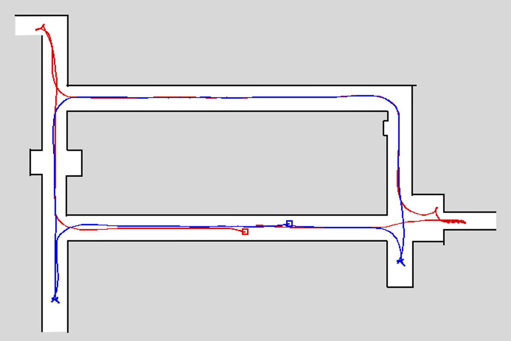
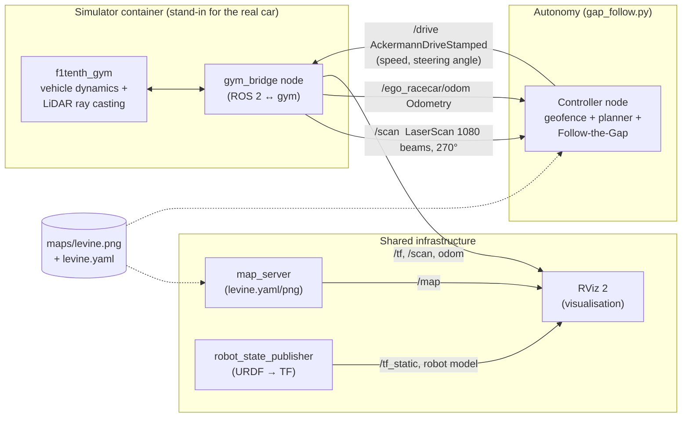
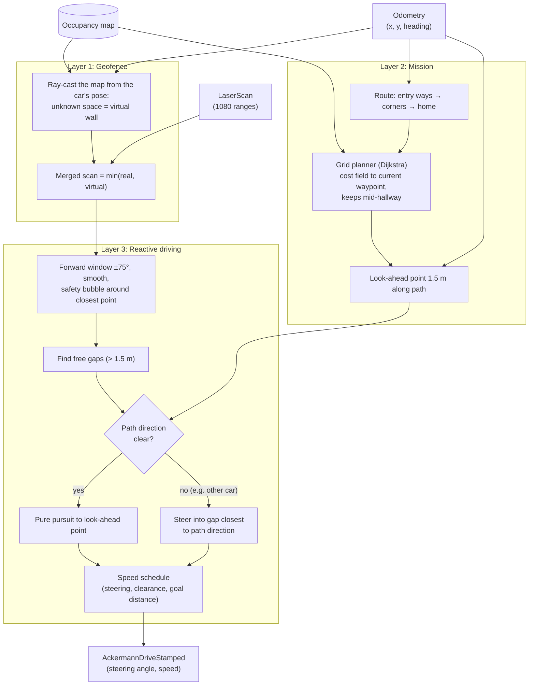
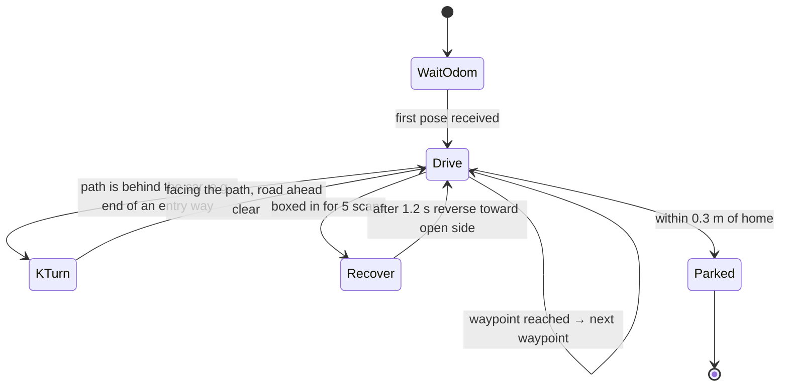
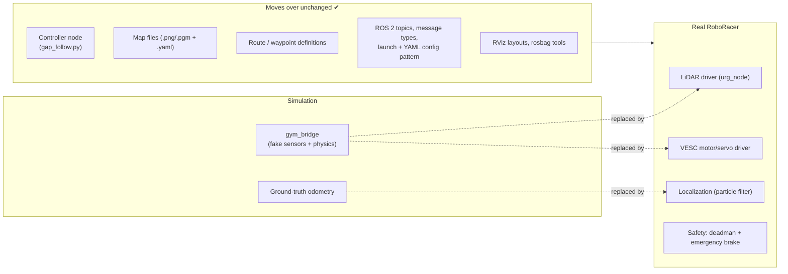
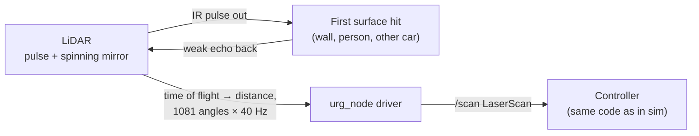
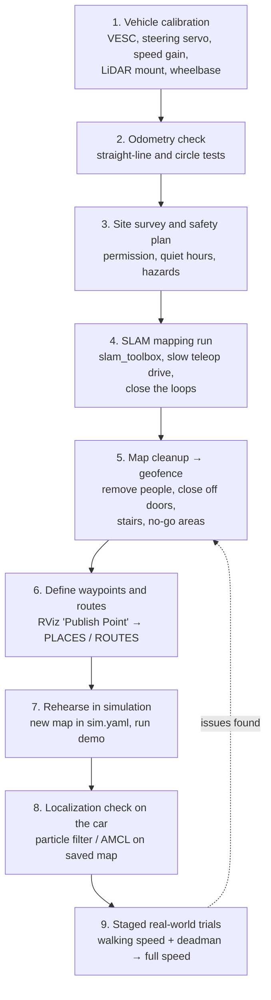
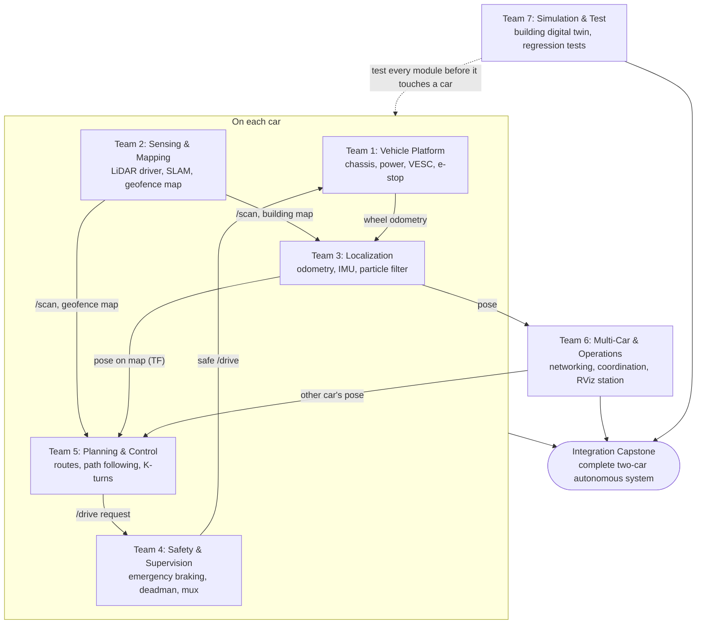
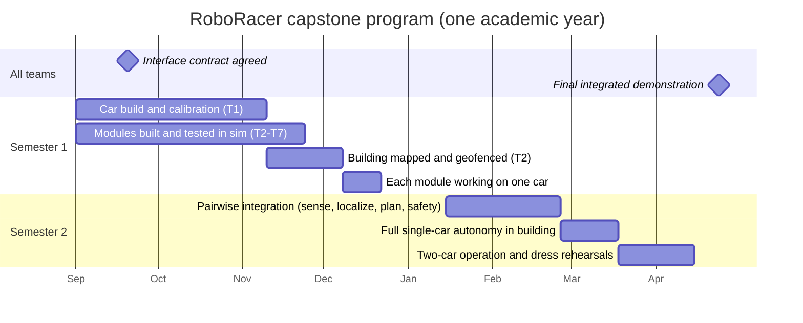

# RoboRacer Platform Guide: Simulation to Real Vehicle

This page explains how the RoboRacer software works, using this simulator as a
stand-in for the real cars. It is written for proposing senior capstone projects
in the Robotics Lab. It covers:

1. [Running the demo](#1-running-the-demo)
2. [Main software components](#2-main-software-components)
3. [Control and data flow inside the controller](#3-control-and-data-flow-inside-the-controller)
4. [What moves from the simulation to the real RoboRacer](#4-what-moves-from-the-simulation-to-the-real-roboracer)
5. [What changes or must be built for the real RoboRacer](#5-what-changes-or-must-be-built-for-the-real-roboracer)
6. [Calibration and mapping a floor of the engineering building](#6-calibration-and-mapping-a-floor-of-the-engineering-building)
7. [Capstone program: separate teams, one integrated system](#7-capstone-program-separate-teams-one-integrated-system)
8. [Glossary](#8-glossary)

---

## 1. Running the demo

The demo runs two cars on the Levine hallway map. Each car:

* drives **counter-clockwise around the loop** of hallways,
* **turns into its assigned entry ways** (side corridors and dead ends), makes a K-turn
  at the end, and comes back out,
* stays **inside the building**. The open ends of the map are treated as walls (a
  "geofence"), so the cars never leave into empty space,
* **dodges the other car** with Follow-the-Gap on the live LiDAR scan,
* **returns to its start hallway and parks** (ego car in the south lane, opponent in
  the north lane).

| Car | Entry ways it explores | Parks at |
|---|---|---|
| Ego (`/drive`) | East corridor, north-west stub | `(-0.5, -0.55)` |
| Opponent (`/opp_drive`) | South-east dead end, south-west corridor | `(2.5, 0.15)` |



*Recorded from a real two-car run in the simulator. Red = ego, blue = opponent, squares =
parking spots. The small "Y" marks at the ends of the entry ways are the K-turns. A full
run takes about 1 minute.*

**Setup (one time):** `config/sim.yaml` must have `num_agent: 2` and the opponent start
`sy1: 0.0`. The upstream value of `0.5` puts the car against the hallway wall, and it
cannot get going. Then run `colcon build` inside the container. The launch file reads the
*installed* copy of `sim.yaml`.

```bash
# Terminal 1 (host)
docker compose up

# Terminal 2: simulator + RViz  (view at http://localhost:8080/vnc.html)
docker exec -it f1tenth_gym_ros-sim-1 /bin/bash
source /opt/ros/foxy/setup.bash && source install/local_setup.bash
ros2 launch f1tenth_gym_ros gym_bridge_launch.py

# Terminal 3: ego car
docker exec -it f1tenth_gym_ros-sim-1 /bin/bash
source /opt/ros/foxy/setup.bash
python3 /sim_ws/src/f1tenth_gym_ros/gap_follow.py

# Terminal 4: opponent car (the sim only advances once BOTH cars get commands)
docker exec -it f1tenth_gym_ros-sim-1 /bin/bash
source /opt/ros/foxy/setup.bash
python3 /sim_ws/src/f1tenth_gym_ros/gap_follow.py --opp
```

To show the second car in RViz, click **Add → RobotModel**, then set
*Description Source* = `Topic` and *Description Topic* = `/opp_robot_description`.

| Option | Effect |
|---|---|
| `--opp` | Drive the opponent car instead of the ego car |
| `--laps N` | Run N extra laps of the loop before going home |
| `--free` | Plain reactive Follow-the-Gap: no map, no route. Useful as a "before" comparison, since the cars wander out of the building's open ends |

To restart a run, Ctrl+C both controllers. Then use RViz **2D Pose Estimate** (ego) and
**2D Goal Pose** (opponent) to put the cars back near their start, or restart Terminal 2.

---

## 2. Main software components

Everything is a **ROS 2 node** that talks over **topics**. The controller only sees
standard message types (`LaserScan`, `Odometry`, `AckermannDriveStamped`), so the
simulator can be swapped for real hardware without changing the controller.



| Component | Where | What it does |
|---|---|---|
| **f1tenth_gym** | Python package in the container | Physics of a 1/10-scale car (single-track dynamic model, tyre slip, steering delay) and a simulated 2D LiDAR made by ray casting into the map image. Steps at 100 Hz. Stops a car that hits a wall. |
| **gym_bridge** | `f1tenth_gym_ros/gym_bridge.py` | Wraps the gym as a ROS 2 node. Publishes `/scan`, odometry and TF. Turns `/drive` commands into gym steps. Handles 1 or 2 cars and pose resets from RViz. |
| **map_server + lifecycle manager** | Nav2 packages, started by the launch file | Serves the occupancy-grid map on `/map` for RViz (and, on the real car, for localization). |
| **robot_state_publisher** | Launch file + `launch/*.xacro` | Publishes the car's geometry (base_link → laser, wheels) as TF so RViz can draw it and data can be moved between frames. |
| **RViz 2** | `launch/gym_bridge.rviz` | Shows the map, cars, LiDAR scan and TF. Also used to reset car poses. |
| **Controller (`gap_follow.py`)** | Repo root | The autonomy software. This is the part that runs on the real car. Described below. |
| **Configuration** | `config/sim.yaml` | Topic names, number of cars, start poses, LiDAR field of view and beam count, map path. |

### Topics used by the demo

| Topic | Type | Direction | Ego / opponent |
|---|---|---|---|
| LiDAR scan | `sensor_msgs/LaserScan` | sim → controller | `/scan` / `/opp_scan` |
| Pose + velocity | `nav_msgs/Odometry` | sim → controller | `/ego_racecar/odom` / `/opp_racecar/odom` |
| Drive command | `ackermann_msgs/AckermannDriveStamped` | controller → sim | `/drive` / `/opp_drive` |
| Map | `nav_msgs/OccupancyGrid` | map_server → RViz | `/map` |

---

## 3. Control and data flow inside the controller

The controller runs once per LiDAR scan (the real car's Hokuyo LiDAR scans at 40 Hz). It
has three layers. Each layer can be explained and tested on its own, which makes them
natural capstone sub-projects.



### Behaviour state machine



* **K-turn:** forward at full steering lock until the front gets close, then reverse with
  the opposite lock. Repeat until the car faces the path. Before each move, the
  controller projects the car's footprint along the arc it is about to drive and checks
  it against the *map*. The LiDAR cannot see the rear 90°, so this is the only protection
  when backing up.
* **Recover:** back up slowly while turning the nose toward the more open side. This is
  the original Follow-the-Gap escape behaviour, now with the same map check.
* **Reverse speed is capped at 0.45 m/s.** The gym's tyre model is only valid for
  forward motion above 0.5 m/s. Reversing faster makes the physics diverge and crashes
  the simulator (found and fixed while building this demo). Real cars do not have this
  limit, but slow reversing is sensible anyway given the rear blind spot.

### Key tuning parameters (top of `gap_follow.py`)

| Parameter | Default | Meaning |
|---|---|---|
| `SPEED_FAST / MED / SLOW` | 3.5 / 2.2 / 1.2 m/s | Speed schedule. Lower these a lot on the real car at first. |
| `GAP_THRESHOLD` | 1.5 m | A beam counts as free beyond this range |
| `BUBBLE_RADIUS` | 0.40 m | Clearance kept around the closest obstacle |
| `LOOKAHEAD` | 1.5 m | Pure-pursuit look-ahead distance |
| `MIN_CLEARANCE` | 0.30 m | Planner keeps the car's centre this far from walls |
| `REVERSE_SPEED` | -0.45 m/s | Reverse speed for K-turns and recovery (sim limit, see above) |
| `PLACES`, `ROUTES` | Levine map | Named waypoints and each car's route (map frame, metres) |

---

## 4. What moves from the simulation to the real RoboRacer

The simulator mirrors the real F1TENTH/RoboRacer hardware closely: the same 1/10-scale
chassis geometry, and a LiDAR model matching the Hokuyo UST-10LX (270°, about 1080
beams, 40 Hz). Most of the software is therefore carried over as is.



| Moves over directly | Notes |
|---|---|
| **The controller node** (`gap_follow.py`): geofence, planner, Follow-the-Gap, K-turn, parking | Same topics and message types. Only the parameters are retuned (speeds, clearances, LiDAR offset). |
| **ROS 2 interfaces** | `/scan` (LaserScan) and `/drive` (AckermannDriveStamped) are the standard F1TENTH topics on the real car as well. |
| **Maps and routes** | A map made on the real car with SLAM loads into *both* the simulator and the controller. Routes are tested in sim first, then on the car. |
| **Workflow** | Docker/ROS 2 build, launch files, YAML config, RViz, rosbag recording. Students learn it once on a laptop. |
| **Testing** | Bags recorded on the real car can be replayed into the controller on a laptop for offline debugging. |

---

## 5. What changes or must be built for the real RoboRacer

| Area | In simulation | On the real car (needs to be implemented or configured) |
|---|---|---|
| **Sensing** | Perfect LiDAR from ray casting | **LiDAR driver** (`urg_node` for Hokuyo, or `sllidar_ros2` for RPLiDAR). Must handle noise, dropouts (`inf`/`NaN`), and glass or shiny surfaces that return nothing. |
| **Actuation** | Speed and steering applied instantly (plus a modelled delay) | **VESC driver** (`vesc_driver`, `ackermann_to_vesc`). Converts m/s to motor ERPM and steering angle to servo position. Needs calibration (section 6). |
| **Pose / odometry** | Ground-truth pose from the simulator | **No ground truth.** Wheel odometry from the VESC (+ optional IMU, fused with `robot_localization`), plus **localization against the map** (F1TENTH `particle_filter` or Nav2 AMCL). This provides the `map → odom → base_link` TF. The controller then reads the localized pose instead of `/ego_racecar/odom`. |
| **Safety** | Crashes cost nothing | **Deadman switch and manual override:** joystick with `ackermann_mux` so a held button is required to drive autonomously. **Automatic emergency braking** (time-to-collision node on `/scan`) that overrides `/drive`. A hard speed cap at the start. Physical e-stop. |
| **Rear blind spot** | Controller checks the car's footprint against the map before reversing | The same map check works, but people and objects behind the car are invisible. Limit reversing speed and distance, or add a rear sensor (ultrasonic or camera). |
| **Dynamic obstacles** | Only the other car | People, doors, carts, backpacks. Follow-the-Gap handles them reactively. Slow down when clearance is low. |
| **Drop-offs and stairs** | Do not exist | **A 2D LiDAR cannot see stairwells or drop-offs.** Close them off in the map (geofence) and with physical barriers. |
| **Frames and geometry** | LiDAR 0.275 m ahead of the car centre | Measure the real LiDAR mount position and wheelbase. Update `LIDAR_OFFSET`, `WHEELBASE` and the URDF/xacro. |
| **Compute** | Desktop PC | Onboard computer (e.g. NVIDIA Jetson Orin Nano) running Ubuntu + ROS 2. Check the controller keeps up at 40 Hz (the map ray cast takes about 2 ms). |
| **Packaging** | Script run by hand | Turn the controller into a proper ROS 2 package with a launch file, ROS parameters instead of constants, and a systemd/launch-at-boot option. |
| **Multi-car** | Both cars in one process space | Each car runs its own ROS 2 graph (different `ROS_DOMAIN_ID`s or namespaces). Sharing positions between cars needs a network link (Wi-Fi). |

### How the real LiDAR works

The real car carries a 2D scanning LiDAR, typically a Hokuyo UST-10LX, the sensor the
simulator models. It does **not** send a continuous beam that bounces back and forth.
It works like this:

1. A laser diode fires a **very short pulse of invisible infrared light** (eye-safe, Class 1).
2. A **spinning mirror** inside the sensor sends each pulse in a slightly different
   direction. The Hokuyo covers 270° in 0.25° steps.
3. The pulse hits the **first surface in its path**: a wall, a person's leg, the other
   car. A tiny fraction of the light scatters back to the sensor. It does not ricochet
   on to other surfaces, and only the first thing hit counts.
4. The sensor measures the **round-trip time** (time of flight). Light covers about
   30 cm per nanosecond, so a wall 5 m away echoes back in about 33 ns. Distance =
   speed of light × time ÷ 2.
5. One full sweep gives about **1081 distances**, repeated **40 times per second** (about
   43,000 measurements per second). Range is about 0.06–10 m.



The driver publishes each sweep as a `LaserScan` message on `/scan`, the **same message
the simulator produces**. The controller cannot tell the difference. That is why the
code moves over unchanged.

**Where the "walls" come from.** Follow-the-Gap steers using the **live scan only**,
in the simulator too. The map is used for two other things: the geofence (virtual
walls) and route planning. On the real car the walls in the scan are real echoes. The
map is one *you* build by driving the car through the building once with SLAM
(section 6). It replaces `maps/levine.*`.

**Real-world limits the simulator does not have:**

* **Glass and mirrors:** light passes through glass or reflects away, so glass walls may
  look like open space. Close them off in the map.
* **Dark or shiny surfaces** return weak echoes and may read as "nothing there".
* **It sees one horizontal slice** at the sensor's height (around 15–20 cm off the floor).
  It misses table tops, overhanging objects and **drop-offs such as stairs**.
* **Rear blind spot:** 270° coverage leaves 90° behind the car unseen.
* Noise of a centimetre or two, occasional missing readings, and rare interference from
  another LiDAR nearby. The driver and controller already ignore invalid readings.

### Seeing the real cars in RViz

Yes. RViz works the same way with real cars. ROS 2 nodes find each other over the
network, so a **laptop on the same Wi-Fi network** (same `ROS_DOMAIN_ID`) can run RViz
and show, live:

* the **building map** you created,
* each car's **estimated position** on that map (from localization),
* the **live LiDAR points** laid over the map. When localization is good, the points
  line up with the map's walls, which makes a useful health check,
* the **planned path** and the current waypoint.

Each car runs in its own namespace (for example `/car1/...`, `/car2/...`), so one RViz
window can show both cars, just like the simulator.

Practical notes:

* **Campus Wi-Fi often blocks the multicast traffic** ROS 2 uses to discover nodes. Use a
  dedicated lab router, or configure a Fast DDS *discovery server*.
* Avoid streaming heavy data such as camera images over Wi-Fi. LiDAR scans and poses are
  small and fine.
* **Foxglove Studio** is a browser-based alternative to RViz that also suits a
  presentation screen.

---

## 6. Calibration and mapping a floor of the engineering building

"Training" here does **not** mean machine learning. The current controller is a classical,
explainable algorithm. Getting the cars ready for a building means calibrating the
hardware, **building a map**, cleaning it into a geofence, and defining routes.
Learning-based driving can be a later capstone topic, trained in this simulator on the
same map.



### Step details

1. **Vehicle calibration** (once per car, repeat after crashes or rebuilds)
   * Run the VESC motor detection (FOC wizard in VESC Tool) and set current and brake limits.
   * **Steering:** find `steering_angle_to_servo_offset` so the car drives straight with
     a 0 command. Find `steering_angle_to_servo_gain` by measuring the turning radius at
     full lock.
   * **Speed:** calibrate `speed_to_erpm_gain` by driving a measured distance (e.g. 10 m)
     and comparing it with odometry.
   * **LiDAR extrinsics:** measure the LiDAR's position and yaw relative to the car frame.
     Check it by facing a flat wall: the scan should show a straight line square to the car.
   * Measure the **wheelbase** and maximum steering angle. Copy them into the URDF and
     controller parameters.
   * IMU bias calibration, if an IMU is used.
2. **Odometry check:** drive a 5 m straight line and a full circle. Wheel odometry should
   be within a few percent. Fix the gains before mapping, because poor odometry makes
   poor maps.
3. **Site survey and safety plan:** get permission from facilities and the department.
   Pick quiet hours. Walk the floor and note glass walls, mirrors, open stairwells,
   elevator doors, fire doors, ramps and floor transitions. Plan a spotter and an e-stop.
4. **SLAM mapping run:** run `slam_toolbox` (online async) with the LiDAR and odometry.
   Drive the car **slowly by joystick** (around 1 m/s) down the centre of every hallway.
   **Return to places already seen** so the SLAM can close loops. Save with
   `ros2 run nav2_map_server map_saver_cli -f engineering_floor2`. The output is a
   `.pgm` image + `.yaml` in the same format as `maps/levine.*`.
5. **Map cleanup (geofence):** open the image in an editor (e.g. GIMP). Erase people and
   carts captured during mapping. **Paint over doorways, stairwells and areas the cars
   must not enter.** Leave everything outside the hallways unknown or grey. The
   controller treats anything that is not known free space as a virtual wall, so this
   painting step directly defines where the cars may drive.
6. **Waypoints and routes:** with the map loaded in RViz, use **Publish Point** on each
   entry way, corner and parking spot. Read the coordinates from `/clicked_point` and
   enter them in `PLACES` and `ROUTES` in `gap_follow.py`.
7. **Rehearse in simulation:** copy the map into `maps/`. Set `map_path`, `sx/sy/stheta`
   (and `sx1/sy1/stheta1`) in `config/sim.yaml`. Point `MAP_YAML` in `gap_follow.py` at
   it. Run `colcon build` and the demo. Fix routes and parameters here, where crashes
   are free.
8. **Localization check:** on the car, run the particle filter with the saved map. Give
   an initial pose in RViz. Push the car by hand around the loop and confirm the
   estimated pose follows the real one. This must work before autonomous driving.
9. **Staged trials:** start at walking speed with the deadman held and a spotter. Then
   enable the entry-way K-turns. Then two cars. Raise the speed caps only after clean runs.

---

## 7. Capstone program: separate teams, one integrated system

### The approach

The RoboRacer is a **system of systems**: hardware, sensing, mapping, localization,
safety, planning and coordination. That makes it a natural fit for **several capstone
teams working in parallel**, each owning one subsystem, with an **integration capstone**
that brings them together. The final deliverable is **one complete autonomous system**.

What makes this work is the **ROS 2 interface contract**. Teams agree early on the
topics and message types between subsystems (the tables in sections 2 and 5). Each team
can then build and test its part on its own, against the simulator or recorded data,
and plug it in later without rewriting anyone else's work. This mirrors how industry
builds autonomous vehicles, and it gives every team a clear, assessable scope.

**The ultimate goal (integration capstone):**

> Two RoboRacer cars autonomously tour a floor of the engineering building. They
> explore its entry ways, avoid people and each other, stay inside geofenced areas, and
> park back at their start. A team monitors them live in RViz, with a human safety
> operator able to stop either car at any time.

This is the simulator demo, made real.

### How the teams fit together



### The capstones

| # | Capstone | Scope | Delivers (interface) | Needs from | Good fit for |
|---|---|---|---|---|---|
| 1 | **Vehicle Platform** | Build and wire the cars: chassis, battery and power, onboard computer, VESC motor/servo controller, physical e-stop. Calibrate steering, speed and LiDAR mount. | A drivable car that accepts `/drive` and publishes wheel odometry. Calibration procedure document. | Nothing (starts first) | ME, EE |
| 2 | **Sensing & Mapping** | LiDAR driver and filtering, SLAM mapping of a building floor, map cleanup and **geofence** editing, site survey of hazards. | Reliable `/scan`. Building map files (`.pgm` + `.yaml`). Map-editing guidelines. | Team 1 (a car to carry the LiDAR) | CompE, CS, EE |
| 3 | **Localization & State Estimation** | Fuse wheel odometry and IMU. Run a particle filter (or AMCL) on the building map. Measure accuracy. | The car's pose on the map (`map → base_link` TF), with an accuracy report. | Teams 1, 2 | ME, CompE, CS |
| 4 | **Safety & Supervision** | Automatic emergency braking (time-to-collision), deadman joystick, command multiplexer, speed limits, watchdogs (stop if a node or the network dies). | A safety layer between planner and motors that **always** has the final say. Test evidence. | Teams 1, 2 | EE, CompE |
| 5 | **Planning & Control** | Turn `gap_follow.py` into a proper ROS 2 package. Route and waypoint tools. Better path following (pure pursuit / MPC). Tune for real dynamics. | `/drive` requests that follow routes in the building. Parameter guide. | Teams 2, 3 (sim until then) | ME, CS |
| 6 | **Multi-Car Coordination & Operations** | Lab network and ROS 2 discovery, sharing positions between cars, right-of-way rules in narrow hallways, operator station (RViz/Foxglove dashboard, start/stop controls). | Two cars that know about each other. An operator console. | Teams 3, 5 | CS, CompE |
| 7 | **Simulation & Test** | Load the building map into this simulator (a "digital twin"). Automated regression tests. Rosbag record/replay tools. Optional machine-learning driving comparison. | A test bench every team uses before touching a real car. | Team 2 (building map). Can start on Levine. | CS |
| ★ | **Integration Capstone** | Owns the interface contract, system-level requirements, integration schedule, safety case and the final demonstration. Can be its own team, or the leads of Teams 1–7 acting together. | **The complete two-car autonomous building tour.** | All teams | Systems / any |

Teams 5, 6 and 7 can start on day one using this simulator. Teams 2–4 begin in the
simulator and move to hardware as soon as Team 1 has a car driving.

### Suggested timeline (two semesters)



*Dates are placeholders for a fall-to-spring academic year. Shift them to the real calendar.*

| Milestone | Evidence |
|---|---|
| **M1: Interface contract** (week 3) | Agreed list of topics, message types, frames and units, signed off by every team |
| **M2: Works in simulation** (week 8) | Each module demonstrated against this simulator or recorded data |
| **M3: Works on hardware** (end of semester 1) | Each module demonstrated on a real car in isolation |
| **M4: Single-car autonomy** (mid semester 2) | One car completes a building route with safety layer active |
| **M5: Final demonstration** (end of semester 2) | Two cars complete the building tour. Each team presents its subsystem and its part in the whole |

**Scaling options:** with fewer students, combine Teams 3 + 5 and Teams 6 + 7. Across
multiple years, year one delivers single-car autonomy and year two adds multi-car
operation and learning-based driving, reusing year one's hardware and software.

---

## 8. Glossary

| Term | Meaning |
|---|---|
| **Ackermann steering** | Car-style steering, where the front wheels turn and the car follows an arc. Commands are a speed plus a steering angle (`AckermannDriveStamped`). |
| **AEB / TTC** | Automatic Emergency Braking using Time-To-Collision: if distance ÷ closing speed drops below a threshold, brake regardless of what the planner says. |
| **Controller** | In this guide, the **autonomy software that drives the car**: `gap_follow.py`, one ROS 2 node per car. It reads the LiDAR scan and position and sends speed and steering commands. On the real car it runs **onboard**, on the car's own computer, not on a remote control. Not to be confused with the *VESC* (the hardware motor controller) or the joystick (the human override). |
| **Deadman switch** | A button the safety operator must hold for the car to drive autonomously. Releasing it stops the car. |
| **Docker / container** | A packaged, self-contained Linux environment. The simulator runs in one so it behaves the same on every computer. |
| **Follow-the-Gap** | A reactive driving method: find the widest or deepest open "gap" in the LiDAR scan and steer into it. |
| **Frame** | A coordinate system attached to something: `map` (the building), `base_link` (the car body), `laser` (the LiDAR). |
| **Geofence** | A **virtual boundary drawn in software** that the car treats as a wall, although nothing physical is there. In this project it is painted into the map: anything that is not known free hallway, such as open ends, off-limits doorways and stairwells, is ray-cast as a "virtual wall" and merged into the LiDAR scan. The car's reactive driving then avoids it like a real wall. It is only as accurate as the car's position estimate, so leave margin, and keep physical barriers at real hazards such as stairs. |
| **Gym** | A standard Python interface for simulators (`reset()`, `step(action)`), from OpenAI Gym / Gymnasium. **f1tenth_gym** is the F1TENTH car simulator built on it, which also makes it ready for machine-learning experiments. |
| **LaserScan** | The ROS message holding one LiDAR sweep: start angle, angle step, and a list of distances. Identical from the simulator and from the real sensor. |
| **LiDAR** | Light Detection And Ranging: measures distance by timing short laser pulses reflected off surfaces. The RoboRacer's LiDAR sweeps a 270° horizontal slice 40 times per second. |
| **Localization** | Working out where the car is on a known map, by matching live LiDAR scans to the map (e.g. with a particle filter or AMCL). The simulator skips this because it knows the true position. |
| **Message** | A typed data structure sent over a topic, e.g. `LaserScan`, `Odometry`, `AckermannDriveStamped`. |
| **Node** | One running program in a ROS 2 system, such as the LiDAR driver, the controller, or RViz. |
| **Occupancy grid map** | The building map as an image: white = free, black = wall, grey = unknown, plus a `.yaml` giving the scale (metres per pixel) and origin. |
| **Odometry** | An estimate of the car's motion and position, from wheel rotation (and optionally an IMU). It drifts over time, which is why localization is needed. |
| **Publish / subscribe** | How nodes communicate: a node *publishes* messages to a named topic, and any node that *subscribes* receives them. There is no central hub. |
| **Pure pursuit** | A path-following method: pick a point a fixed distance ahead on the path and steer along the arc that reaches it. |
| **ROS 2** | Robot Operating System 2: the open-source middleware (not an operating system) that connects nodes, moves data between them, and provides tools such as RViz, TF and rosbag. |
| **rosbag** | A recording of topic data (e.g. LiDAR and odometry from a real run) that can be replayed later for debugging. |
| **RViz** | The ROS 3D visualization tool. It **displays** maps, cars, scans and paths, but does not run the simulation. Works the same with real cars over Wi-Fi. |
| **robot_state_publisher** | The node that reads the robot's URDF and publishes the fixed positions of its parts as TF. |
| **SLAM** | Simultaneous Localization And Mapping: building a map of an unknown place while tracking where you are in it. Used once to map the building (e.g. `slam_toolbox`). |
| **TF** (`/tf`, `/tf_static`) | ROS's transform system, which tracks how every frame relates to every other over time. `/tf` carries moving relationships (car on map). `/tf_static` carries fixed ones (LiDAR on chassis). It lets any node convert "2 m ahead of the LiDAR" into a point on the building map. |
| **Topic** | A named data channel, such as `/scan` or `/drive`. |
| **URDF / xacro** | Unified Robot Description Format: an XML description of the robot's parts (links) and how they connect (joints). xacro is URDF with macros. The source of the robot's static TF and its 3D model in RViz. |
| **VESC** | An open-source electronic speed controller that drives the motor and steering servo and reports wheel speed for odometry. |
| **Waypoint / route** | A named point on the map, such as an entry way, corner or parking spot, and the ordered list of them a car drives through. |
