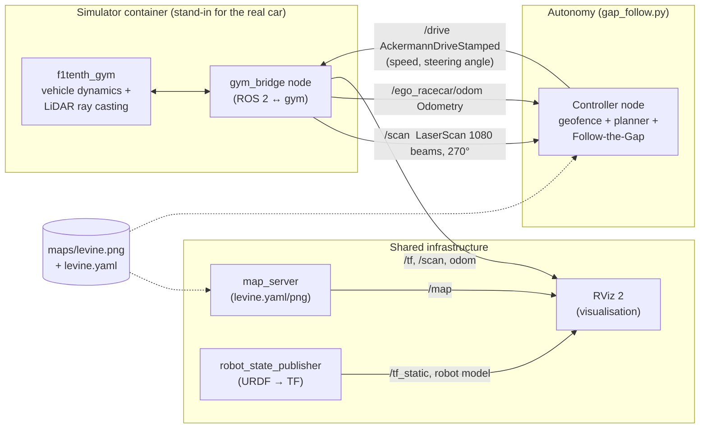
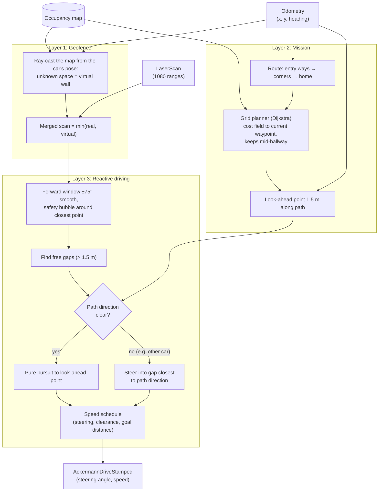
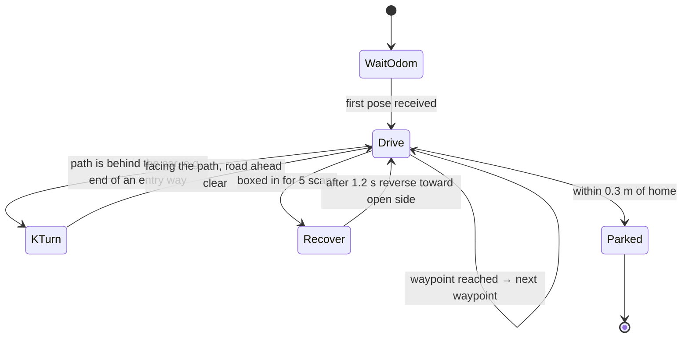
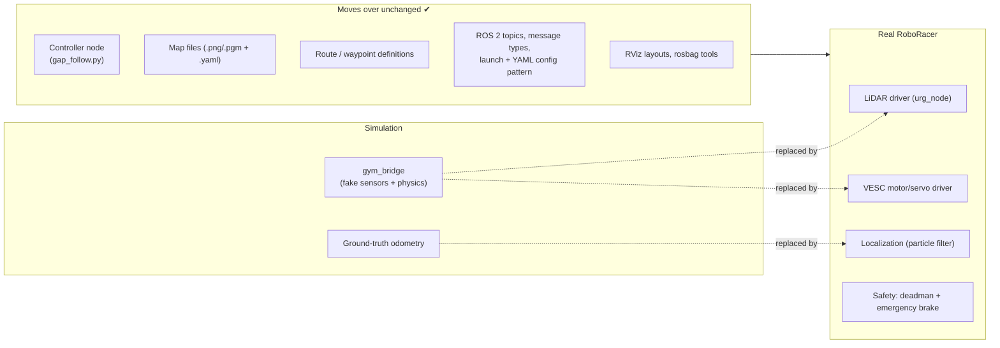
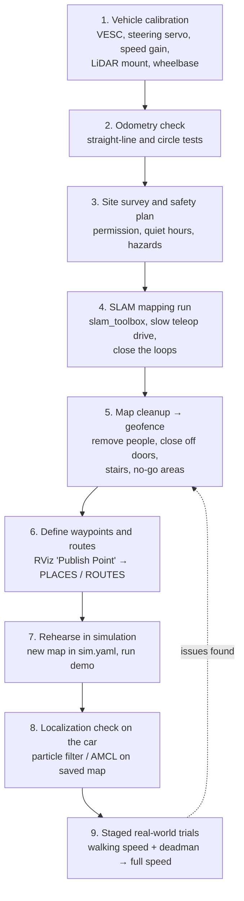

# RoboRacer Platform Guide: Simulation to Real Vehicle

This page explains how the RoboRacer software works, using this simulator as a
stand-in for the real cars. It is written for proposing senior capstone projects
in the Robotics Lab. It covers:

1. [Running the demo](#1-running-the-demo)
2. [Main software components](#2-main-software-components)
3. [Control and data flow inside the controller](#3-control-and-data-flow-inside-the-controller)
4. [What moves from the simulation to the real RoboRacer](#4-what-moves-from-the-simulation-to-the-real-roboracer)
5. [What changes or must be built for the real RoboRacer](#5-what-changes-or-must-be-built-for-the-real-roboracer)
6. [Calibration and mapping a floor of the engineering building](#6-calibration-and-mapping-a-floor-of-the-engineering-building)
7. [Suggested capstone work packages](#7-suggested-capstone-work-packages)

---

## 1. Running the demo

The demo runs two cars on the Levine hallway map. Each car:

* drives **counter-clockwise around the loop** of hallways,
* **turns into its assigned entry ways** (side corridors and dead ends), makes a K-turn
  at the end, and comes back out,
* stays **inside the building**. The open ends of the map are treated as walls (a
  "geofence"), so the cars never leave into empty space,
* **dodges the other car** with Follow-the-Gap on the live LiDAR scan,
* **returns to its start hallway and parks** (ego car in the south lane, opponent in
  the north lane).

| Car | Entry ways it explores | Parks at |
|---|---|---|
| Ego (`/drive`) | East corridor, north-west stub | `(-0.5, -0.55)` |
| Opponent (`/opp_drive`) | South-east dead end, south-west corridor | `(2.5, 0.15)` |


*Recorded from a real two-car run in the simulator. Red = ego, blue = opponent, squares =
parking spots. The small "Y" marks at the ends of the entry ways are the K-turns. A full
run takes about 1 minute.*

**Setup (one time):** `config/sim.yaml` must have `num_agent: 2` and the opponent start
`sy1: 0.0`. The upstream value of `0.5` puts the car against the hallway wall, and it
cannot get going. Then run `colcon build` inside the container. The launch file reads the
*installed* copy of `sim.yaml`.

```bash
# Terminal 1 (host)
docker compose up

# Terminal 2: simulator + RViz  (view at http://localhost:8080/vnc.html)
docker exec -it f1tenth_gym_ros-sim-1 /bin/bash
source /opt/ros/foxy/setup.bash && source install/local_setup.bash
ros2 launch f1tenth_gym_ros gym_bridge_launch.py

# Terminal 3: ego car
docker exec -it f1tenth_gym_ros-sim-1 /bin/bash
source /opt/ros/foxy/setup.bash
python3 /sim_ws/src/f1tenth_gym_ros/gap_follow.py

# Terminal 4: opponent car (the sim only advances once BOTH cars get commands)
docker exec -it f1tenth_gym_ros-sim-1 /bin/bash
source /opt/ros/foxy/setup.bash
python3 /sim_ws/src/f1tenth_gym_ros/gap_follow.py --opp
```

To show the second car in RViz, click **Add → RobotModel**, then set
*Description Source* = `Topic` and *Description Topic* = `/opp_robot_description`.

| Option | Effect |
|---|---|
| `--opp` | Drive the opponent car instead of the ego car |
| `--laps N` | Run N extra laps of the loop before going home |
| `--free` | Plain reactive Follow-the-Gap: no map, no route. Useful as a "before" comparison, since the cars wander out of the building's open ends |

To restart a run, Ctrl+C both controllers. Then use RViz **2D Pose Estimate** (ego) and
**2D Goal Pose** (opponent) to put the cars back near their start, or restart Terminal 2.

---

## 2. Main software components

Everything is a **ROS 2 node** that talks over **topics**. The controller only sees
standard message types (`LaserScan`, `Odometry`, `AckermannDriveStamped`), so the
simulator can be swapped for real hardware without changing the controller.



| Component | Where | What it does |
|---|---|---|
| **f1tenth_gym** | Python package in the container | Physics of a 1/10-scale car (single-track dynamic model, tyre slip, steering delay) and a simulated 2D LiDAR made by ray casting into the map image. Steps at 100 Hz. Stops a car that hits a wall. |
| **gym_bridge** | `f1tenth_gym_ros/gym_bridge.py` | Wraps the gym as a ROS 2 node. Publishes `/scan`, odometry and TF. Turns `/drive` commands into gym steps. Handles 1 or 2 cars and pose resets from RViz. |
| **map_server + lifecycle manager** | Nav2 packages, started by the launch file | Serves the occupancy-grid map on `/map` for RViz (and, on the real car, for localization). |
| **robot_state_publisher** | Launch file + `launch/*.xacro` | Publishes the car's geometry (base_link → laser, wheels) as TF so RViz can draw it and data can be moved between frames. |
| **RViz 2** | `launch/gym_bridge.rviz` | Shows the map, cars, LiDAR scan and TF. Also used to reset car poses. |
| **Controller (`gap_follow.py`)** | Repo root | The autonomy software. This is the part that runs on the real car. Described below. |
| **Configuration** | `config/sim.yaml` | Topic names, number of cars, start poses, LiDAR field of view and beam count, map path. |

### Topics used by the demo

| Topic | Type | Direction | Ego / opponent |
|---|---|---|---|
| LiDAR scan | `sensor_msgs/LaserScan` | sim → controller | `/scan` / `/opp_scan` |
| Pose + velocity | `nav_msgs/Odometry` | sim → controller | `/ego_racecar/odom` / `/opp_racecar/odom` |
| Drive command | `ackermann_msgs/AckermannDriveStamped` | controller → sim | `/drive` / `/opp_drive` |
| Map | `nav_msgs/OccupancyGrid` | map_server → RViz | `/map` |

---

## 3. Control and data flow inside the controller

The controller runs once per LiDAR scan (the real car's Hokuyo LiDAR scans at 40 Hz). It
has three layers. Each layer can be explained and tested on its own, which makes them
natural capstone sub-projects.



### Behaviour state machine



* **K-turn:** forward at full steering lock until the front gets close, then reverse with
  the opposite lock. Repeat until the car faces the path. Before each move, the
  controller projects the car's footprint along the arc it is about to drive and checks
  it against the *map*. The LiDAR cannot see the rear 90°, so this is the only protection
  when backing up.
* **Recover:** back up slowly while turning the nose toward the more open side. This is
  the original Follow-the-Gap escape behaviour, now with the same map check.
* **Reverse speed is capped at 0.45 m/s.** The gym's tyre model is only valid for
  forward motion above 0.5 m/s. Reversing faster makes the physics diverge and crashes
  the simulator (found and fixed while building this demo). Real cars do not have this
  limit, but slow reversing is sensible anyway given the rear blind spot.

### Key tuning parameters (top of `gap_follow.py`)

| Parameter | Default | Meaning |
|---|---|---|
| `SPEED_FAST / MED / SLOW` | 3.5 / 2.2 / 1.2 m/s | Speed schedule. Lower these a lot on the real car at first. |
| `GAP_THRESHOLD` | 1.5 m | A beam counts as free beyond this range |
| `BUBBLE_RADIUS` | 0.40 m | Clearance kept around the closest obstacle |
| `LOOKAHEAD` | 1.5 m | Pure-pursuit look-ahead distance |
| `MIN_CLEARANCE` | 0.30 m | Planner keeps the car's centre this far from walls |
| `REVERSE_SPEED` | -0.45 m/s | Reverse speed for K-turns and recovery (sim limit, see above) |
| `PLACES`, `ROUTES` | Levine map | Named waypoints and each car's route (map frame, metres) |

---

## 4. What moves from the simulation to the real RoboRacer

The simulator mirrors the real F1TENTH/RoboRacer hardware closely: the same 1/10-scale
chassis geometry, and a LiDAR model matching the Hokuyo UST-10LX (270°, about 1080
beams, 40 Hz). Most of the software is therefore carried over as is.



| Moves over directly | Notes |
|---|---|
| **The controller node** (`gap_follow.py`): geofence, planner, Follow-the-Gap, K-turn, parking | Same topics and message types. Only the parameters are retuned (speeds, clearances, LiDAR offset). |
| **ROS 2 interfaces** | `/scan` (LaserScan) and `/drive` (AckermannDriveStamped) are the standard F1TENTH topics on the real car as well. |
| **Maps and routes** | A map made on the real car with SLAM loads into *both* the simulator and the controller. Routes are tested in sim first, then on the car. |
| **Workflow** | Docker/ROS 2 build, launch files, YAML config, RViz, rosbag recording. Students learn it once on a laptop. |
| **Testing** | Bags recorded on the real car can be replayed into the controller on a laptop for offline debugging. |

---

## 5. What changes or must be built for the real RoboRacer

| Area | In simulation | On the real car (needs to be implemented or configured) |
|---|---|---|
| **Sensing** | Perfect LiDAR from ray casting | **LiDAR driver** (`urg_node` for Hokuyo, or `sllidar_ros2` for RPLiDAR). Must handle noise, dropouts (`inf`/`NaN`), and glass or shiny surfaces that return nothing. |
| **Actuation** | Speed and steering applied instantly (plus a modelled delay) | **VESC driver** (`vesc_driver`, `ackermann_to_vesc`). Converts m/s to motor ERPM and steering angle to servo position. Needs calibration (section 6). |
| **Pose / odometry** | Ground-truth pose from the simulator | **No ground truth.** Wheel odometry from the VESC (+ optional IMU, fused with `robot_localization`), plus **localization against the map** (F1TENTH `particle_filter` or Nav2 AMCL). This provides the `map → odom → base_link` TF. The controller then reads the localized pose instead of `/ego_racecar/odom`. |
| **Safety** | Crashes cost nothing | **Deadman switch and manual override:** joystick with `ackermann_mux` so a held button is required to drive autonomously. **Automatic emergency braking** (time-to-collision node on `/scan`) that overrides `/drive`. A hard speed cap at the start. Physical e-stop. |
| **Rear blind spot** | Controller checks the car's footprint against the map before reversing | The same map check works, but people and objects behind the car are invisible. Limit reversing speed and distance, or add a rear sensor (ultrasonic or camera). |
| **Dynamic obstacles** | Only the other car | People, doors, carts, backpacks. Follow-the-Gap handles them reactively. Slow down when clearance is low. |
| **Drop-offs and stairs** | Do not exist | **A 2D LiDAR cannot see stairwells or drop-offs.** Close them off in the map (geofence) and with physical barriers. |
| **Frames and geometry** | LiDAR 0.275 m ahead of the car centre | Measure the real LiDAR mount position and wheelbase. Update `LIDAR_OFFSET`, `WHEELBASE` and the URDF/xacro. |
| **Compute** | Desktop PC | Onboard computer (e.g. NVIDIA Jetson Orin Nano) running Ubuntu + ROS 2. Check the controller keeps up at 40 Hz (the map ray cast takes about 2 ms). |
| **Packaging** | Script run by hand | Turn the controller into a proper ROS 2 package with a launch file, ROS parameters instead of constants, and a systemd/launch-at-boot option. |
| **Multi-car** | Both cars in one process space | Each car runs its own ROS 2 graph (different `ROS_DOMAIN_ID`s or namespaces). Sharing positions between cars needs a network link (Wi-Fi). |

---

## 6. Calibration and mapping a floor of the engineering building

"Training" here does **not** mean machine learning. The current controller is a classical,
explainable algorithm. Getting the cars ready for a building means calibrating the
hardware, **building a map**, cleaning it into a geofence, and defining routes.
Learning-based driving can be a later capstone topic, trained in this simulator on the
same map.



### Step details

1. **Vehicle calibration** (once per car, repeat after crashes or rebuilds)
   * Run the VESC motor detection (FOC wizard in VESC Tool) and set current and brake limits.
   * **Steering:** find `steering_angle_to_servo_offset` so the car drives straight with
     a 0 command. Find `steering_angle_to_servo_gain` by measuring the turning radius at
     full lock.
   * **Speed:** calibrate `speed_to_erpm_gain` by driving a measured distance (e.g. 10 m)
     and comparing it with odometry.
   * **LiDAR extrinsics:** measure the LiDAR's position and yaw relative to the car frame.
     Check it by facing a flat wall: the scan should show a straight line square to the car.
   * Measure the **wheelbase** and maximum steering angle. Copy them into the URDF and
     controller parameters.
   * IMU bias calibration, if an IMU is used.
2. **Odometry check:** drive a 5 m straight line and a full circle. Wheel odometry should
   be within a few percent. Fix the gains before mapping, because poor odometry makes
   poor maps.
3. **Site survey and safety plan:** get permission from facilities and the department.
   Pick quiet hours. Walk the floor and note glass walls, mirrors, open stairwells,
   elevator doors, fire doors, ramps and floor transitions. Plan a spotter and an e-stop.
4. **SLAM mapping run:** run `slam_toolbox` (online async) with the LiDAR and odometry.
   Drive the car **slowly by joystick** (around 1 m/s) down the centre of every hallway.
   **Return to places already seen** so the SLAM can close loops. Save with
   `ros2 run nav2_map_server map_saver_cli -f engineering_floor2`. The output is a
   `.pgm` image + `.yaml` in the same format as `maps/levine.*`.
5. **Map cleanup (geofence):** open the image in an editor (e.g. GIMP). Erase people and
   carts captured during mapping. **Paint over doorways, stairwells and areas the cars
   must not enter.** Leave everything outside the hallways unknown or grey. The
   controller treats anything that is not known free space as a virtual wall, so this
   painting step directly defines where the cars may drive.
6. **Waypoints and routes:** with the map loaded in RViz, use **Publish Point** on each
   entry way, corner and parking spot. Read the coordinates from `/clicked_point` and
   enter them in `PLACES` and `ROUTES` in `gap_follow.py`.
7. **Rehearse in simulation:** copy the map into `maps/`. Set `map_path`, `sx/sy/stheta`
   (and `sx1/sy1/stheta1`) in `config/sim.yaml`. Point `MAP_YAML` in `gap_follow.py` at
   it. Run `colcon build` and the demo. Fix routes and parameters here, where crashes
   are free.
8. **Localization check:** on the car, run the particle filter with the saved map. Give
   an initial pose in RViz. Push the car by hand around the loop and confirm the
   estimated pose follows the real one. This must work before autonomous driving.
9. **Staged trials:** start at walking speed with the deadman held and a spotter. Then
   enable the entry-way K-turns. Then two cars. Raise the speed caps only after clean runs.

---

## 7. Suggested capstone work packages

Each item maps to one block in the diagrams above. Teams of 3–4 students could each take one:

| Work package | Deliverable |
|---|---|
| Vehicle build and calibration | Assembled car, calibrated VESC, servo and LiDAR, documented procedure |
| Mapping and geofencing | Cleaned map of an engineering-building floor, map-editing guidelines |
| Localization | Particle filter tuned on the building map, accuracy report |
| Safety layer | Emergency braking + deadman + speed limiting, tested and documented |
| Planning and control | Port of `gap_follow.py` into a ROS 2 package with parameters. Pure pursuit / MPC improvements |
| Multi-car coordination | Sharing positions between cars, right-of-way rules in hallways |
| Learning-based driving (stretch) | Imitation or reinforcement learning policy trained in this simulator on the building map, compared with Follow-the-Gap |
